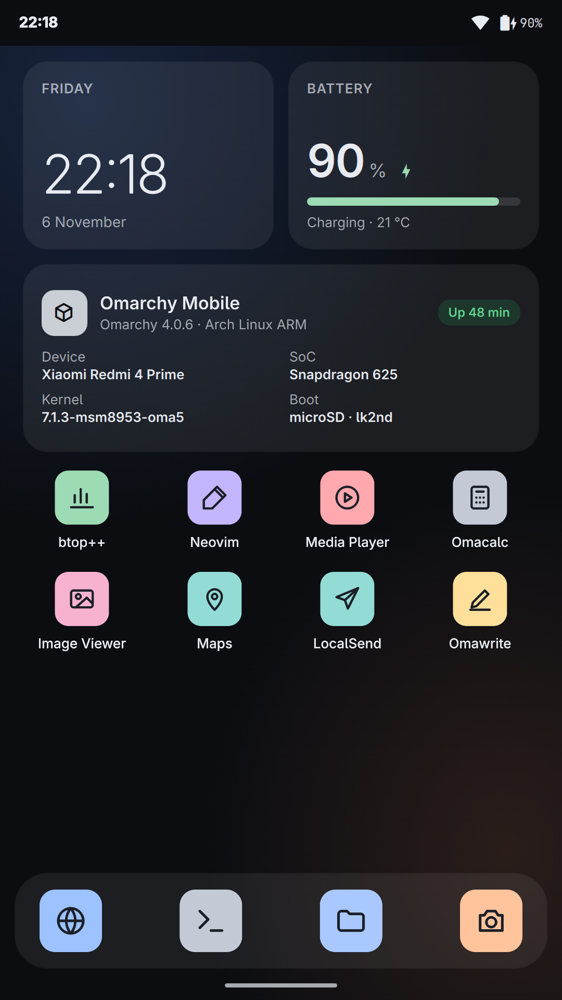
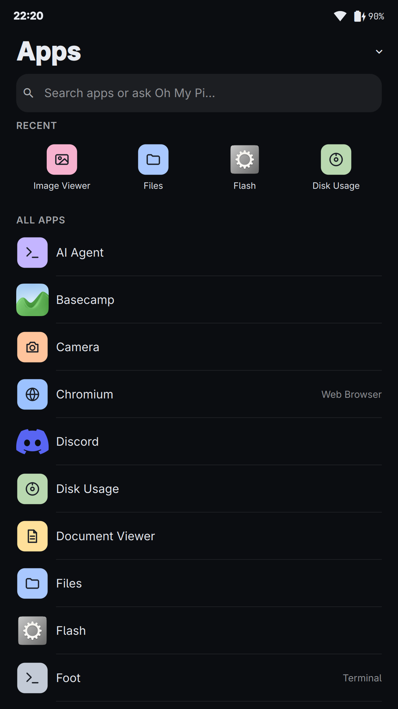
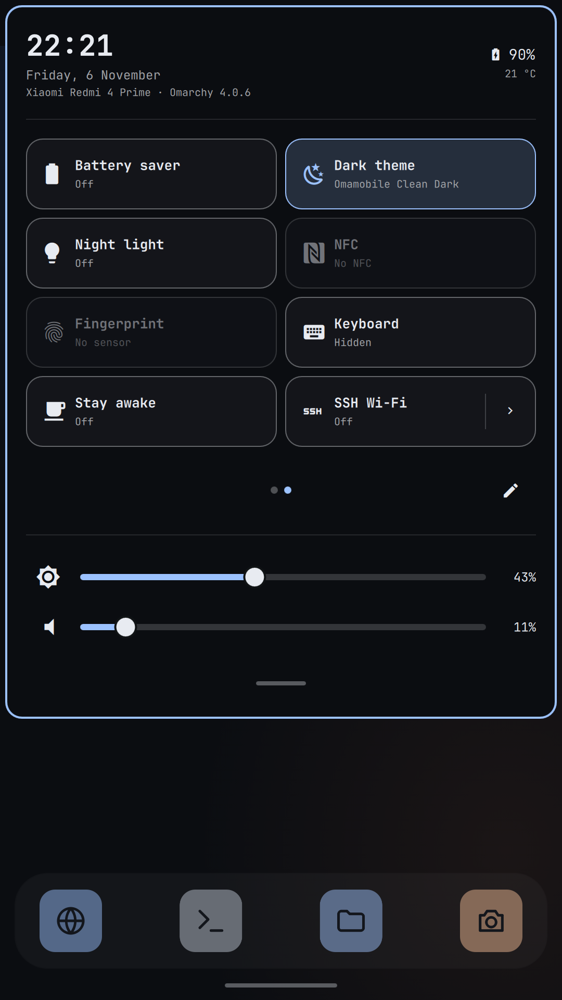

# Omarchy Mobile for the Redmi 4 Prime (markw)

This repository is a **fork of [Omarchy Mobile](https://github.com/derekross/omarchy-mobile)** by Derek Ross and the Omarchy Mobile contributors. It ports Omarchy Mobile to one more phone, the **Xiaomi Redmi 4 Prime (codename `markw`)**.

All the credit for Omarchy Mobile itself belongs to the original project: the shell, the packages, the build and install tooling, the safety model, and the Pixel 7 Pro bring-up this port builds on. Read the original project's [README](UPSTREAM-README.md) (kept here unchanged), [CONTRIBUTING.md](CONTRIBUTING.md) and [docs/DEVICES.md](docs/DEVICES.md) for the project as a whole. This fork adds a device; it does not replace the upstream project.

  
  
  

## What Omarchy Mobile is

Omarchy Mobile runs native [Omarchy](https://omarchy.org) on phones: Arch Linux ARM, Hyprland and Omarchy's own packages, on a mainline Linux kernel, with no Android underneath. The upstream reference device is the Google Pixel 7 Pro (`cheetah`).

## What this fork adds

| Path | What it is |
| --- | --- |
| `device/markw/` | The markw port: bring-up plans and runbooks (`BRINGUP-*.md`), hardware notes (`NOTES.md`), the RAM-boot initramfs, the kernel config fragment and kernel patches |
| `packages/omamobile-device-markw` | Device policy: firmware copied from the phone's own partitions at boot, zram, audio UCM profile, sensors, rmtfs for the modem on RAM copies, USB gadget recovery, auto-suspend (off by default) |
| `packages/omamobile-flash` | "Flash": build and upload PlatformIO and Arduino projects to an ESP32 or ESP8266 over USB OTG, with a serial monitor |
| `packages/omamobile-ssh-wifi` | SSH over Wi-Fi for a limited time, as a second link while the USB port is in use |
| `packages/tqftpserv`, `packages/pd-mapper` | Qualcomm modem helper services for mobile data |
| `tools/build-markw-kernel`, `tools/build-markw-probe`, `tools/build-markw-sd`, `tools/markw-*` | Build the markw kernel, a RAM-loaded boot image and the microSD root; debug, charge-log and OTG-watch helpers |

Changes to shared packages (`omamobile-shell`, `omamobile-omarchy`, `mesa`, `omamobile-firstboot`) add what markw needs: a smaller screen scale, touch keys, Adreno (freedreno) graphics, and some small fixes.

## The device

| | |
| --- | --- |
| Phone | Xiaomi Redmi 4 Prime |
| Codename | `markw` |
| SoC | Qualcomm Snapdragon 625 (MSM8953) |
| PMIC / charger | PM8953 + PMI8950 |
| Kernel | [msm8953-mainline/linux](https://github.com/msm8953-mainline/linux) (the tree behind postmarketOS's `linux-postmarketos-qcom-msm8953`), with this fork's patches in `device/markw/kernel/patches` |
| Boot | [lk2nd](https://github.com/msm8953-mainline/lk2nd) loaded into RAM over fastboot, then a RAM-loaded boot image; the Arch root lives on a microSD card |

Nothing is written to the phone's internal storage (eMMC). MIUI stays installed and boots normally when the phone restarts. A persistent install comes later, once the port is mature enough.

## Status

Verified on one phone, newest details in [device/markw/NOTES.md](device/markw/NOTES.md).

| Area | Status |
| --- | --- |
| Boot (lk2nd in RAM, root on microSD) | works |
| Display, touch, touch keys | works |
| GPU (Adreno 506, freedreno) | works |
| USB networking (NCM + SSH) | works; after some replugs the link needs a gadget rebind (automatic since device-markw 0.1.17) |
| Wi-Fi | works |
| Speaker and microphone | works |
| Light and proximity sensor | works |
| Camera | reported working by the owner, not documented yet |
| Charging | partial: stops at about 90 % (a battery-overvoltage latch); a kernel fix is under test |
| Suspend | testing: short sleeps wake reliably, a long unattended sleep once didn't; auto-suspend stays off |
| Mobile data | in progress: the modem boots on Linux, a SIM test is next (SMS and calls are out of scope for now) |
| USB OTG host | testing: flashing an ESP32 works; getting the laptop link back afterwards is being fixed |
| Bluetooth | not tested yet |
| Persistent install | not yet |

## Branches

- `omamobile-markw-plan` (default) holds the markw work.
- `main` mirrors the upstream project.

## Credits and sources

- [Omarchy Mobile](https://github.com/derekross/omarchy-mobile): Derek Ross and contributors. This fork's origin, MIT licensed.
- [Omarchy](https://omarchy.org): the desktop this all runs.
- [msm8953-mainline](https://github.com/msm8953-mainline): the mainline kernel and lk2nd for MSM8953 phones.
- [postmarketOS](https://postmarketos.org): device knowledge and the MSM8953 kernel packaging.
- Qualcomm's GPL kernel sources (the msm8953 `qpnp-smbcharger` driver), read as a reference for the charger fix.

Firmware is never part of this repository. It is copied at boot from the phone's own partitions.

## License

MIT, as upstream: see [LICENSE](LICENSE). Copyright for the original work remains with Derek Ross and the Omarchy Mobile contributors.
